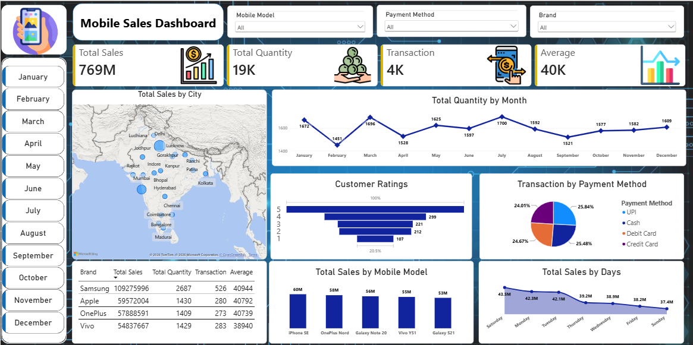

# Mobile Sales Analysis Dashboard

A Power BI dashboard project created as part of the **30 Days Power BI Micro Course** by **SkillCourse**, under the guidance of **Satish Dhawale**.

## Project Overview

This project explores mobile sales data and presents the information through a Power BI report. The report file is included so that the dashboard can be opened and explored in Power BI Desktop.

## Repository Structure

```text
Power-BI-Mobile-Sales-Dashboard/
├── Mobile_Sales_Analysis_Dashboard.pbix
├── Dataset/
│   └── Mobile_Sales_Dataset.xlsx
├── Screenshots/
│   └── README.md
└── README.md
```

## Files

| File | Description |
|---|---|
| `Mobile_Sales_Analysis_Dashboard.pbix` | Power BI report file |
| `Dataset/Mobile_Sales_Dataset.xlsx` | Excel source dataset used for the project |
| `Screenshots/` | Folder for dashboard preview images |

## Dataset

The included Excel workbook contains the source data for the dashboard.

- **Worksheet:** `Sheet1` — 3,835 data rows and 14 columns.
  - **Columns:** Transaction ID, Day, Month, Year, Day Name, Brand, Units Sold, Price Per Unit, Customer Name, Customer Age, City, Payment Method, Customer Ratings, Mobile Model

## Tools Used

- Microsoft Power BI
- Microsoft Excel

## Dashboard Preview

The screenshot below shows the completed Mobile Sales Dashboard, including sales KPIs, city-wise sales, monthly quantity trends, customer ratings, payment methods, mobile model sales, and sales by day.



## How to Open

1. Download or clone this repository.
2. Open `Mobile_Sales_Analysis_Dashboard.pbix` in Power BI Desktop.
3. If Power BI requests the source file, point it to `Dataset/Mobile_Sales_Dataset.xlsx`.
4. Refresh the data if required.

## Learning Context

This project was completed as part of the **30 Days Power BI Micro Course** from **SkillCourse**.

Special thanks to **Satish Dhawale** for his guidance throughout the course.

---

*Created for learning and portfolio purposes.*
